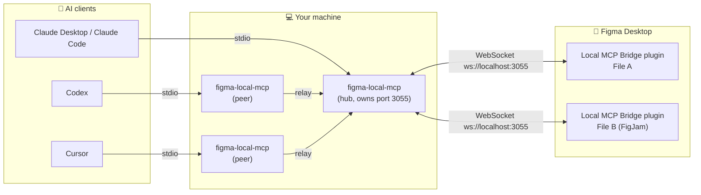

<div align="center">

<p>
  
  &nbsp;&nbsp;&nbsp;&nbsp;&nbsp;&nbsp;
  
  &nbsp;
  
  &nbsp;
  
</p>

# Figma Local MCP Bridge

**Let Claude, Codex and Cursor read and edit your open Figma Desktop files through a bridge that runs on your own machine.**
<br>
No cloud relay and no per-call quota. Your AI client talks to a small local server, and the server talks to a Figma plugin.

<p>
  
  
  
  
</p>
<p>
  
  
  
  
  
</p>

[Quick start](#-quick-start) •
[Connect your AI client](#-step-4--connect-your-ai-client) •
[Tools](#-available-tools) •
[Configuration](#configuration) •
[Troubleshooting](#-troubleshooting)

</div>

---

## ✨ Why this bridge?

| | Figma Local MCP Bridge | Hosted Figma connectors |
|---|---|---|
| **Where it runs** | On your machine (`ws://localhost:3055`) | In the cloud |
| **Call limits** | No quota. Calls are only paced so Figma stays responsive | Calls count against your Figma plan |
| **Read and write** | Read, create, edit, delete, export, plus the full Plugin API through `execute_figma_code` | Often read-only or limited |
| **Several AI apps at once** | Yes. Claude, Codex and Cursor can share one bridge | Usually one per connection |
| **Several open files** | Yes. Each call names a `target` file | Varies |
| **FigJam** | Supported | Varies |
| **Internet access for the plugin** | Not needed. Images are downloaded by the local server | Required |

---

## 🧭 How it works



1. Each AI client starts its own copy of the **MCP server** (`mcp-server/`) over stdio.
2. The first copy to bind port **3055** becomes the **hub**. The others become **peers** and forward their calls to the hub. If the hub exits, a peer takes over the port and the plugins reconnect to it.
3. The **Figma plugin** (`figma-plugin/`) runs inside each Figma file you open it in and connects to the hub over WebSocket.
4. The hub keeps one **paced queue per file** (500 ms gap by default), so bursts of AI calls don't freeze the Figma UI.

---

## ✅ Requirements

| Requirement | Version / notes | Check |
|---|---|---|
|  **Node.js** | 20 or newer | `node -v` |
|  **npm** | Comes with Node.js | `npm -v` |
|  **Git** | Any recent version | `git --version` |
|  **Figma Desktop app** | Development plugins can only be imported in the desktop app, not in the browser | [Download](https://www.figma.com/downloads/) |
| 🤖 **An MCP client** | Claude Desktop, Claude Code, Codex or Cursor | See [Step 4](#-step-4--connect-your-ai-client) |

> [!NOTE]
> You need edit access to a Figma file to run development plugins in it.

---

## 🚀 Quick start

| Step | What you do | Time |
|:---:|---|:---:|
| **1** | [Clone the repository](#-step-1--clone-the-repository) | 1 min |
| **2** | [Install and build](#-step-2--install-and-build) | 1–2 min |
| **3** | [Import the plugin into Figma Desktop](#-step-3--import-the-plugin-into-figma-desktop) | 1 min |
| **4** | [Connect your AI client](#-step-4--connect-your-ai-client) | 2 min |
| **5** | [Run the plugin and say hello](#-step-5--run-the-plugin-and-test-the-connection) | 1 min |

### 📥 Step 1 — Clone the repository

```bash
git clone https://github.com/zubaironai-dotcom/figma-local-mcp.git
```

```bash
cd figma-local-mcp
```

> [!TIP]
> Remember the full path of this folder. You will paste it into your AI client's config in Step 4.
> Examples: `D:/GitHub/figma-local-mcp` on Windows, `/Users/you/figma-local-mcp` on macOS.

### 🔨 Step 2 — Install and build

The repository is an npm workspace with two packages: `mcp-server` and `figma-plugin`. One install and one build cover both.

```bash
npm install
```

```bash
npm run build
```

After the build you should have these two files:

| File | What it is |
|---|---|
| `mcp-server/dist/index.js` | The MCP server your AI client launches |
| `figma-plugin/code.js` | The compiled plugin that Figma loads |

> [!IMPORTANT]
> `figma-plugin/code.js` is not committed to Git. If you skip `npm run build`, Figma will not be able to load the plugin.

### 🎨 Step 3 — Import the plugin into Figma Desktop

1. Open the **Figma Desktop** app and open any design or FigJam file.
2. From the main menu choose **Plugins → Development → Import plugin from manifest…**
3. Select `figma-plugin/manifest.json` inside this repository.
4. The plugin **Local MCP Bridge** now appears under **Plugins → Development**.

You only need to import it once. Figma remembers it.

### 🤖 Step 4 — Connect your AI client

Every client launches the same command: `node <repo>/mcp-server/dist/index.js`. Pick your client below and replace `<repo>` with the full path from Step 1.

| Client | Config location | How to add |
|---|---|---|
|  **Claude Desktop** | `claude_desktop_config.json` | Settings → Developer → Edit Config |
|  **Claude Code** | Claude Code's MCP settings | `claude mcp add` command |
|  **Codex** (CLI, IDE extension, app) | `~/.codex/config.toml` | `codex mcp add` command or edit the file |
|  **Cursor** | `~/.cursor/mcp.json` (global) or `.cursor/mcp.json` (project) | Settings → MCP → Add new MCP server |

> [!TIP]
> **Windows users:** use forward slashes in paths (`D:/GitHub/figma-local-mcp/...`) or escape backslashes in JSON (`D:\\GitHub\\...`).

<details open>
<summary><b> Claude Desktop</b></summary>

<br>

1. Open Claude Desktop → **Settings → Developer → Edit Config**.
   - Windows: `%APPDATA%\Claude\claude_desktop_config.json`
   - macOS: `~/Library/Application Support/Claude/claude_desktop_config.json`
2. Add the server:

```json
{
  "mcpServers": {
    "figma-local": {
      "command": "node",
      "args": ["<repo>/mcp-server/dist/index.js"]
    }
  }
}
```

3. Quit Claude Desktop completely and open it again. The Figma tools appear in the tools menu of a new chat.

</details>

<details>
<summary><b> Claude Code</b></summary>

<br>

Add the server for your user account so it works in every project:

```bash
claude mcp add figma-local --scope user -- node <repo>/mcp-server/dist/index.js
```

Check that it is registered:

```bash
claude mcp list
```

In the desktop app's Code tab, start a new session after adding it.

</details>

<details>
<summary><b> Codex (CLI, IDE extension and desktop app)</b></summary>

<br>

All Codex surfaces read the same `~/.codex/config.toml`. Either run:

```bash
codex mcp add figma-local -- node <repo>/mcp-server/dist/index.js
```

or add this to `~/.codex/config.toml` yourself:

```toml
[mcp_servers.figma-local]
command = "node"
args = ["<repo>/mcp-server/dist/index.js"]
# execute_figma_code can run for up to 10 minutes; give tool calls room to finish.
tool_timeout_sec = 600
```

Restart Codex after editing the file.

</details>

<details>
<summary><b> Cursor</b></summary>

<br>

1. Open **Cursor Settings → MCP → Add new global MCP server**. This opens `~/.cursor/mcp.json`. For a single project, create `.cursor/mcp.json` in that project instead.
2. Add the server:

```json
{
  "mcpServers": {
    "figma-local": {
      "command": "node",
      "args": ["<repo>/mcp-server/dist/index.js"]
    }
  }
}
```

3. Back in **Settings → MCP**, check that `figma-local` shows a green dot and lists its tools.

</details>

> [!NOTE]
> You can connect **all of these clients at the same time**. The first one to start becomes the hub and the others share it.

### 🔌 Step 5 — Run the plugin and test the connection

1. In Figma Desktop, open the file you want the AI to work on.
2. Run **Plugins → Development → Local MCP Bridge**. A small window opens.
3. Make sure your AI client is running. It starts the MCP server for you.
4. The plugin window should show:

| Plugin status | Meaning |
|---|---|
| 🟢 **Connected to MCP server** | Ready. The window also shows the file name, page and `connectionId` |
| 🔴 **Disconnected, retrying in 3s** | No server on port 3055 yet. Start or restart your AI client; the plugin keeps retrying |

5. Ask your AI client:

> *"Call `bridge_status` and tell me which Figma files are connected."*

Then try something real:

> *"Read my current Figma selection and describe its layout."*
> *"Create a 360×640 frame called Login with vertical auto layout, a title and two input fields."*

> [!IMPORTANT]
> Keep the plugin window open while you work. Closing it disconnects that file from the bridge.

---

## 🧰 Available tools

The server exposes **25 tools**. Every Figma tool accepts an optional `target` (`fileName`, `fileKey` or `connectionId`).

<details open>
<summary><b>📖 Read</b></summary>

| Tool | What it does |
|---|---|
| `get_document_info` | File name, connectionId, pages, current page, current user and top-level layers |
| `get_selection` | Properties of every selected node |
| `read_node` | A node and its descendants (`depth`, `maxNodes`, or `textOnly` for just the text) |
| `search_nodes` | Find layers by name, text or type; paginated with `cursor` |
| `get_design_tokens` | Local paint, text, effect and grid styles, plus variable collections and variables |
| `get_components` | Local components and component sets with their variants |
| `export_node` | Render a node as PNG, JPG or SVG, returned inline or saved with `saveTo` |

</details>

<details>
<summary><b>✏️ Create</b></summary>

| Tool | What it does |
|---|---|
| `create_frame` | Frame, with auto layout set through `properties` |
| `create_rectangle` | Solid rectangle with optional corner radius |
| `create_ellipse` | Ellipse |
| `create_text` | Text layer; the font is loaded for you (default Inter Regular) |
| `create_instance` | Instance of a local component (`componentId`) or a library component (`componentKey`) |
| `create_page` | New page |

</details>

<details>
<summary><b>🛠️ Edit</b></summary>

| Tool | What it does |
|---|---|
| `update_text` | Replace text in a text layer, sticky, shape with text or connector |
| `set_node_properties` | Set any writable Plugin API property (`x`, `opacity`, `layoutMode`, `fills`, …) |
| `set_image_fill` | Use an image from an http(s) or `data:` URL as a fill (PNG, JPEG or GIF, up to 10 MB) |
| `clone_node` | Duplicate a node, optionally into another parent or position |
| `delete_nodes` | Delete layers by ID |
| `set_selection` | Select nodes and zoom to them |
| `set_current_page` | Switch to another page |

</details>

<details>
<summary><b>⚡ Full access and bridge control</b></summary>

| Tool | What it does |
|---|---|
| `execute_figma_code` | Run JavaScript with the full Figma Plugin API. Supports `dryRun`, `timeoutMs` up to 10 minutes, and 13 `helpers` (`walk`, `findAll`, `getNode`, `loadFontsFor`, `exportImage`, …). Each call is one undo step |
| `get_call_result` | Look up an earlier call by `callId`, e.g. after a timeout or disconnect |
| `set_default_target` | Make one file the default for calls without a `target`; survives plugin reloads |
| `bridge_status` | Connected files, MCP clients sharing the bridge, queue depth and recent calls |
| `configure_bridge` | Change the gap between calls to the same file (`paceMs`) for every client |

</details>

### Good to know

- **Changes are reported.** Editing calls return the IDs they created, deleted and modified (up to 50 per list; `get_call_result` has the full lists).
- **Undo works.** Each call is a single undo step in Figma.
- **Big results don't flood the chat.** Text results over 100,000 characters and very large images are saved to your temp folder (`figma-local-mcp/`) and returned as a file path plus a preview.

---

## 🗂️ Working with several files

Run the plugin in each file you want the AI to use. When more than one file is connected, every call must say which file it is for, otherwise it is refused instead of guessing:

| Option | Example prompt |
|---|---|
| Name the file in each request | *"In the file **Mobile App v2**, list the components."* |
| Set a default once | *"Call `set_default_target` with fileName **Mobile App v2**."* |
| Clear the default | *"Call `set_default_target` with no target."* |

The default follows the file, not the plugin window, so it keeps working after you reload the plugin.

---

<a id="configuration"></a>

## ⚙️ Configuration

Optional environment variables for the MCP server:

| Variable | Default | What it controls |
|---|---|---|
| `FIGMA_MCP_PACE_MS` | `500` | Gap in ms between calls to the same file. Lower is faster; higher is gentler on large files. Can also be changed at runtime with `configure_bridge` |
| `FIGMA_MCP_PEER_IDLE_MS` | `600000` (10 min) | How long an idle peer stays connected to the hub before disconnecting until its next call |
| `FIGMA_MCP_PORT` | `3055` | WebSocket port |

Example for JSON-based clients (Claude Desktop, Cursor):

```json
{
  "mcpServers": {
    "figma-local": {
      "command": "node",
      "args": ["<repo>/mcp-server/dist/index.js"],
      "env": { "FIGMA_MCP_PACE_MS": "250" }
    }
  }
}
```

For Codex, add an `env` table to `config.toml`:

```toml
[mcp_servers.figma-local.env]
FIGMA_MCP_PACE_MS = "250"
```

> [!WARNING]
> The plugin is hard-wired to `ws://localhost:3055` in `figma-plugin/manifest.json` and `figma-plugin/ui.html`. If you change `FIGMA_MCP_PORT`, change both of those files to match, rebuild, and re-import the plugin.

---

## 🩺 Troubleshooting

| Problem | Likely cause | Fix |
|---|---|---|
| Plugin says **Disconnected, retrying in 3s** | No MCP server is running | Open your AI client (it starts the server). In Claude Desktop, quit fully and reopen |
| **Local MCP Bridge** is missing from the Plugins menu | Plugin not imported, or you are using Figma in the browser | Use the Figma Desktop app and redo [Step 3](#-step-3--import-the-plugin-into-figma-desktop) |
| Figma can't load the plugin / `code.js` not found | The plugin was not built | Run `npm run build` in the repository folder |
| AI client shows no Figma tools | Wrong path in the config, or Node.js not on `PATH` | Use the full absolute path to `mcp-server/dist/index.js`; run `node -v` to check Node.js; restart the client |
| Calls fail with an ambiguous target error | The plugin is open in more than one file | Pass a `target` or use `set_default_target` |
| Result contains `warnings` about versions | Plugin and server come from different builds | Re-run the plugin in Figma and restart the AI client |
| A call ended with status `unknown` | Timeout or disconnect mid-call | Ask the AI to call `get_call_result` with that `callId` before retrying |
| Port 3055 is used by another app | Port conflict | Stop the other app, or change the port (see [Configuration](#configuration)) |
| Codex stops long scripts early | Default tool timeout is short | Set `tool_timeout_sec = 600` for `figma-local` in `config.toml` |

Server logs go to stderr with the prefix `[figma-local-mcp]`. Your AI client shows them in its MCP logs.

---

## 🔄 Updating

```bash
git pull
```

```bash
npm install
```

```bash
npm run build
```

The build only rewrites `figma-plugin/code.js` when it actually changed; when it does, Figma reloads the running plugins on its own. Restart your AI client so it picks up the new server.

---

## 🧪 Development

| Command | What it does |
|---|---|
| `npm run build` | Build the MCP server and the Figma plugin |
| `npm start` | Start the MCP server on stdio (normally your AI client does this) |
| `npm test` | Full end-to-end test against a simulated Figma (no Figma needed) |
| `npm run test:quick` | Same, without the 32-second long-script check |
| `npm run watch -w mcp-server` | Rebuild the server on change |

### Project structure

```text
figma-local-mcp/
├── mcp-server/            MCP server (Node.js, TypeScript)
│   └── src/
│       ├── index.ts       Tool definitions, result formatting, image downloads
│       ├── link.ts        Hub/peer networking, per-file queues, change tracking
│       ├── protocol.ts    Shared types and BridgeError
│       └── queue.ts       Paced serial queue
├── figma-plugin/          Figma plugin "Local MCP Bridge"
│   ├── manifest.json      Plugin manifest (import this into Figma)
│   ├── code.ts            Runs commands with the Figma Plugin API
│   ├── ui.html            WebSocket connection and status window
│   └── publish.mjs        Copies the build to code.js only when it changed
└── test/                  End-to-end tests with a mocked Figma
```

---

## 🔒 Privacy and security

- The plugin only connects to `ws://localhost:3055` on your own machine (see `networkAccess` in `manifest.json`). It has no internet access.
- Images for `set_image_fill` are downloaded by the local server, not by Figma.
- `execute_figma_code` runs any JavaScript your AI client sends, with full access to the open file. Review what your AI is about to do on important files, and use `dryRun` to preview changes.

---

<div align="center">

**Built for designers and developers who want their AI tools working directly in Figma.**

 &nbsp;
 &nbsp;
 &nbsp;


<sub>Figma, Claude, Codex, OpenAI and Cursor are trademarks of their respective owners. This project is not affiliated with or endorsed by them.</sub>

</div>
